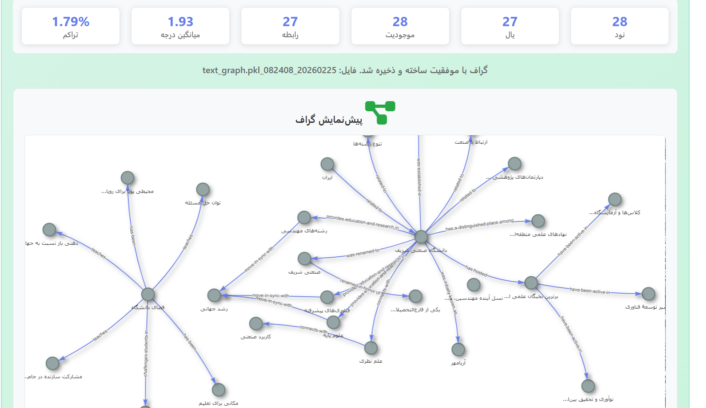
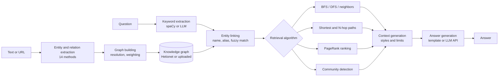
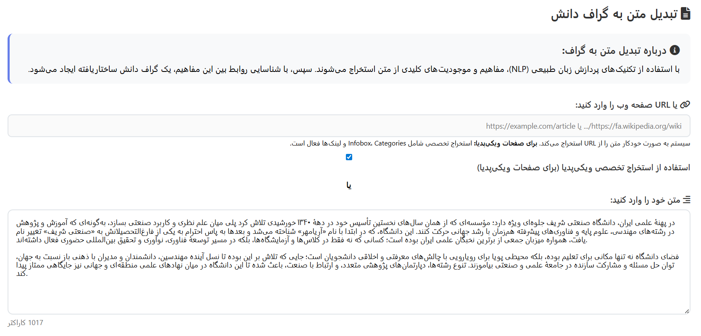
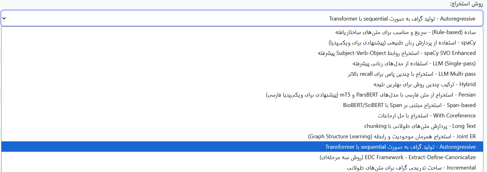
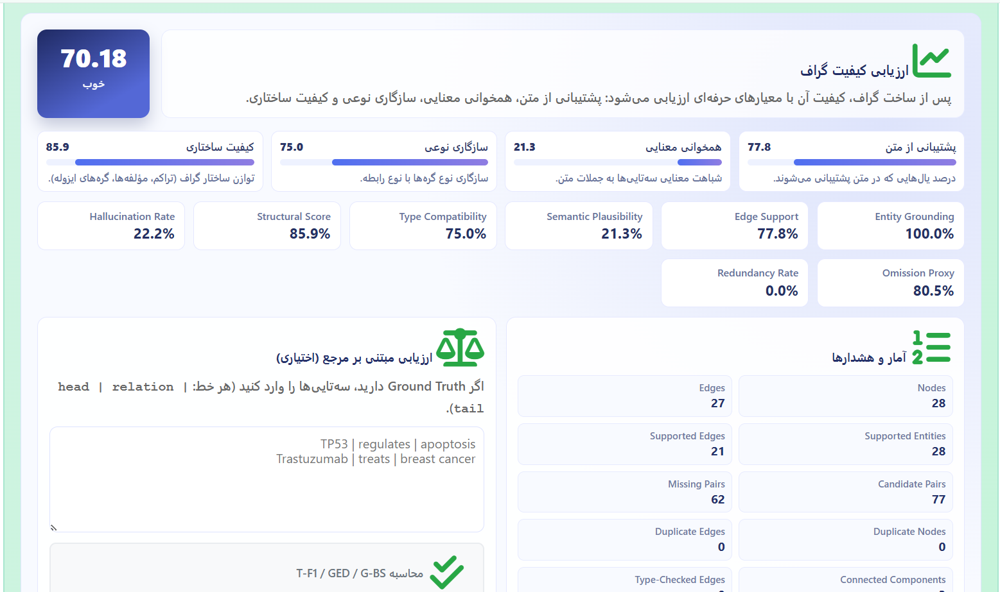
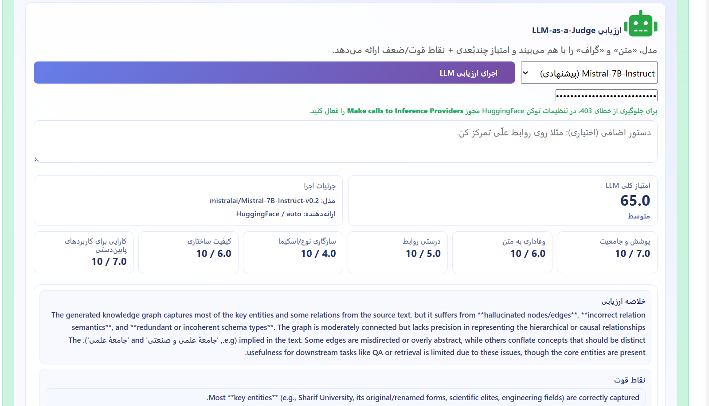

# GraphRAG: Knowledge-Graph Retrieval-Augmented Generation over Hetionet

[](LICENSE)

GraphRAG answers biomedical questions by retrieving evidence from a knowledge graph instead of from text chunks. A question is mapped to graph entities, a graph algorithm collects the relevant nodes, edges, and paths, and the result is turned into a context that a language model (or a local template) uses to write the answer. The default graph is [Hetionet v1.0](https://het.io), and new graphs can be built from free text or web pages and queried the same way.

This is the B.Sc. thesis project of **Amirhossein Khoshbakht** and **Ali Rahimi** at Sharif University of Technology, supervised by Dr. Hamid Beigy.



## Features

**Question answering over a knowledge graph**
- Entity linking: keywords are extracted with spaCy (or an LLM) and matched to graph nodes by exact, alias, and fuzzy name lookup. Persian questions are normalized and mapped to English entity names.
- Graph retrieval with a choice of algorithms: BFS, DFS, shortest paths, direct neighbors, hybrid and multi-method search, N-hop path retrieval, PageRank-based ranking, and community-based retrieval (Louvain, label propagation, Girvan–Newman, spectral clustering).
- Context generation in several styles (scientific, narrative, data-driven, step-by-step, biological pathway, clinical relevance, and others), with configurable limits on nodes, edges, depth, and context length.
- Answer generation with a local template model (no API key needed) or with OpenAI, Anthropic, Google Gemini, or Hugging Face models.

**Building graphs from text**
- Input as raw text or a URL; Wikipedia pages get a dedicated extractor (infobox, categories, links).
- Fourteen extraction methods, from rule-based (`simple`, `spacy`, `spacy_svo_enhanced`) to LLM-based (`llm`, `llm_multipass`, `autoregressive`, `edc`), joint and span-based models (`joint_er`, `span_based` with BioBERT), coreference resolution, Persian-language extraction, and chunked extraction for long documents (`long_text`, `incremental`).
- Entity resolution, relation weighting, and optional removal of isolated nodes before the graph is saved as a NetworkX graph that the QA pipeline can load.
- Built-in graph-quality checks: automatic metrics (entity grounding, edge support in the source text, type compatibility, structural statistics, redundancy) and an optional LLM-as-a-judge review.

**Web interface** (Flask) for asking questions, uploading graphs, converting text to graphs, browsing and managing saved graphs, and comparing answers.

## Architecture



| Component | File |
|---|---|
| QA pipeline: entity linking, retrieval, context, generation | `graphrag_service.py` |
| Context styles | `enhanced_context_generator.py` |
| Retrieval add-ons (KG search, N-hop, PageRank, community detection, entity resolution) | `graphrag_new/` |
| Text-to-graph extraction and graph building | `text_to_graph_service.py`, `span_based_extractor.py`, `bert_relation_extractor.py`, `coreference_resolver.py`, `smart_chunker.py`, `hierarchical_merger.py`, `modular_pipeline.py` |
| URL and Wikipedia text extraction | `url_extractor.py`, `wikipedia_extractor.py` |
| Persian support | `persian_normalizer.py`, `persian_models.py` |
| Web app and REST API | `web_app.py`, `templates/`, `static/` |
| Building the Hetionet graph from the raw files | `rebuild_graph.py`, `main_grpahrag.py` |

## Data

Hetionet v1.0 integrates 29 public biomedical resources. The files in this repository contain **47,031 nodes** of 11 types (20,945 genes, 11,381 biological processes, 5,734 side effects, 2,884 molecular functions, 1,822 pathways, 1,552 compounds, 1,391 cellular components, 438 symptoms, 402 anatomies, 345 pharmacologic classes, 137 diseases) and **2,250,197 edges** of 24 relation types (for example `DaG` disease–associates–gene, `CtD` compound–treats–disease, `CbG` compound–binds–gene). The prebuilt `hetionet_graph.pkl` is an undirected NetworkX graph in which parallel edges between the same pair of nodes are merged, leaving 2,107,709 edges.

| File | Content |
|---|---|
| `hetionet-v1.0-nodes.tsv` | node id, name, kind |
| `edges.sif` | source, metaedge, target |
| `hetionet_graph.pkl` | NetworkX graph built from the two files above, loaded by default |

These files are not stored in git. `python scripts/download_data.py` downloads the raw files from [hetio/hetionet](https://github.com/hetio/hetionet) and runs `rebuild_graph.py` to build the pickle (see [Installation](#installation)).

## Installation

Requires Python 3.10 or newer (developed on 3.13).

```bash
git clone https://github.com/amirhosseinkho/graphRAG.git
cd graphRAG
python -m venv .venv && source .venv/bin/activate   # Windows: .venv\Scripts\activate
pip install -r requirements.txt
python -m spacy download en_core_web_sm

# Download Hetionet v1.0 (about 15 MB compressed) and build hetionet_graph.pkl
python scripts/download_data.py
```

API keys are optional and are read from the environment or from a `.env` file:

| Variable | Used for |
|---|---|
| `OPENAI_API_KEY` | OpenAI answer generation, LLM keyword extraction, and the judge |
| `HF_TOKEN` | Hugging Face models for LLM-based text-to-graph extraction and the judge |

Without any key, the template generator and the rule-based extractors still work.

## Usage

### Web app

```bash
python web_app.py
```

Open `http://localhost:5000`. The pages are `/` (question answering), `/upload_graph` (text or URL to graph), `/manage_graphs`, `/view_graph`, and `/evaluation`.

### Python

The output below is from a real run on the Hetionet graph built by `scripts/download_data.py`, with the template generator (no API key):

```python
from graphrag_service import GraphRAGService, RetrievalMethod, GenerationModel

service = GraphRAGService("hetionet_graph.pkl")
result = service.process_query(
    "What is the relationship between TP53 and breast cancer?",
    RetrievalMethod.SHORTEST_PATH,
    GenerationModel.SIMPLE,
)
print(result["paths"][:2])
# [['Gene::7157', 'Disease::DOID:1612'], ['Gene::7157', 'Gene::4869', 'Disease::DOID:0060073']]
print(result["answer"][:150])
# 🔗 RELATIONSHIPS FOUND:
#
# 📌 DAG (5 connections):
#   • TP53 (Gene) → breast cancer (Disease)
#   • breast cancer (Disease) → CDKN1A (Gene) ...
```

`RetrievalMethod` selects the algorithm (`INTELLIGENT`, `BFS`, `DFS`, `SHORTEST_PATH`, `NEIGHBORS`, `HYBRID`, `MULTI_METHOD`, `N_HOP_RETRIEVAL`, `PAGERANK_BASED`, `COMMUNITY_DETECTION`, ...) and `GenerationModel` selects the answer generator (`SIMPLE` for the local template, or the OpenAI, Anthropic, Gemini, and Hugging Face options).

### REST API

```bash
# Question answering
curl -X POST http://localhost:5000/api/process_query -H "Content-Type: application/json" \
  -d '{"query": "What is the relationship between TP53 and breast cancer?", "retrieval_method": "SHORTEST_PATH", "generation_model": "SIMPLE"}'

# Text to graph (saved under uploaded_graphs/ and returned for preview)
curl -X POST http://localhost:5000/api/text_to_graph -H "Content-Type: application/json" \
  -d '{"text": "Metformin treats type 2 diabetes. Metformin activates AMPK.", "method": "spacy"}'
```

Other endpoints: `/api/upload_graph`, `/api/list_graphs`, `/api/load_graph`, `/api/graph_view_data`, `/api/evaluate_text_to_graph`, `/api/evaluate_text_to_graph_llm`, `/api/compare_with_gpt`, and `/api/config`.

## Screenshots

| Text or URL input | Extraction methods |
|---|---|
|  |  |

| Automatic graph-quality metrics | LLM-as-a-judge review |
|---|---|
|  |  |

The interface is in Persian. The graph at the top of this page was built from a Persian paragraph with an LLM-based extractor.

## Evaluation

The evaluation checks whether retrieval puts the correct answer entities into the context that would be sent to the LLM. Every number below comes from `evaluation/results/2026-10-09_summary.json`, produced by the scripts in `evaluation/` at commit `e5b5815`. The run used a CPU-only Windows laptop on 2026-10-09.

**Questions.** `evaluation/make_questions.py` generates 56 questions from Hetionet itself (seed 42), with 8 questions for each of 7 templates. Six templates follow one relation: genes associated with a disease, compounds that treat a disease, genes a compound binds, symptoms of a disease, anatomies where a disease localizes, and side effects of a compound. One template follows two relations: genes bound by compounds that treat a disease. The gold answers are read directly from the graph edges. Each question has 3–30 gold answers (3–60 for the two-hop template).

**Systems.**
- **GraphRAG** with three of its retrieval methods: `INTELLIGENT` (the relation-guided search), `BFS` (the web interface default), and `ADAPTIVE`. All three use the default configuration.
- **Dense RAG baseline** (`evaluation/baseline_rag.py`). Every Hetionet edge is rendered as text, grouped by node and relation. For example: "hypertension (Disease). Compounds that treat it: …". This gives 334,555 chunks of up to 400 characters, embedded with `all-MiniLM-L6-v2`. The top chunks by cosine similarity are concatenated up to 2,000 characters, the same as GraphRAG's configured `max_context_length`.

**Metrics.** No LLM API key was available, so only retrieval is evaluated, not answer quality.
- *Recall in first 2,000 chars*: the share of gold entities that appear in the first 2,000 characters of the context. This compares all systems at the same context size.
- *Recall in full context* and *hit rate*: the share of gold entities in the whole context, and the share of questions with at least one gold entity there.
- *Node recall*: the share of gold entities among the graph nodes GraphRAG retrieved, before the context is built.

Questions slower than 10 minutes would count as failures; none reached that limit.

| System | n | Recall in first 2,000 chars | Recall in full context | Hit rate | Node recall | Mean context (chars) | Mean latency (s) |
|---|---|---|---|---|---|---|---|
| GraphRAG `INTELLIGENT` | 56 | 31.3% | 31.9% | 57.1% | 31.4% | 55,876 | 57 |
| GraphRAG `BFS` | 56 | 13.1% | 13.1% | 35.7% | 12.9% | 4,741 | 6.5 |
| GraphRAG `ADAPTIVE` | 56 | 5.4% | 5.4% | 23.2% | 4.9% | 1,734 | 9.2 |
| Dense RAG baseline | 56 | 88.1% | 88.1% | 96.4% | n/a | 1,850 | 0.04 |

Recall in the first 2,000 characters, by question template:

| Template | `INTELLIGENT` | `BFS` | `ADAPTIVE` | Dense RAG |
|---|---|---|---|---|
| Disease → associated genes | 35.3% | 1.1% | 4.2% | 100.0% |
| Disease → treating compounds | 71.1% | 17.5% | 13.6% | 100.0% |
| Compound → bound genes | 0.0% | 37.1% | 0.0% | 100.0% |
| Disease → symptoms | 28.8% | 14.2% | 7.7% | 100.0% |
| Disease → anatomies | 8.3% | 3.5% | 8.7% | 100.0% |
| Compound → side effects | 56.2% | 18.2% | 3.3% | 100.0% |
| Disease → compounds → bound genes (2 hops) | 19.3% | 0.3% | 0.0% | 16.4% |

To reproduce the run (after `scripts/download_data.py`):

```bash
python evaluation/make_questions.py
python evaluation/run_eval.py      # add --llm-model gpt-4o-mini with OPENAI_API_KEY set to also score answers
```

### Limitations

- **The baseline is favoured by the benchmark design.** The questions and the baseline's text chunks are both generated from the same Hetionet edges. A chunk header such as "uterine cancer (Disease). Compounds that treat it:" nearly paraphrases its question, so one-hop questions are close to ideal for dense retrieval. This setup measures retrieval over Hetionet's own content, not over free text. When the answer is spread across many chunks (the two-hop template), the baseline drops to 16.4%, slightly below `INTELLIGENT` at 19.3%.
- **GraphRAG's main errors come from entity matching and question typing, not from graph search.** Inspecting the matched nodes shows three repeated failures:
  - Generic words are matched to unrelated nodes: "genes" and "compounds" to Gene Ontology processes, "symptoms" to a side effect, "effects" to a pathway.
  - Multi-word disease names are matched only partly: "uterine cancer", "lung cancer" and "larynx cancer" all map to the generic *cancer* node.
  - Some phrasings fall through the question-type rules. "Which genes does X bind?" and "In which anatomical structures does X localize?" are classified as *general*, which explains the 0% and 8% recall on those templates.
- **`INTELLIGENT` contexts do not respect the configured length limit.** They average 55,876 characters (maximum 161,513), against the 2,000-character setting. Its recall barely changes when the context is cut to 2,000 characters, because the relevant nodes are listed first. Parts of the context templates are written in Persian.
- **Retrieval is slow on the full graph.** On CPU, `INTELLIGENT` takes about 57 s per question. Two output-preserving fixes made during this evaluation (enumerating only the first shortest paths, and skipping the neighbour scan at the last DFS level) removed a worst case of about one hour per question. The baseline answers in 0.04 s, but only after a one-time embedding of the corpus that took about 2.5 hours on CPU.
- **Two retrieval methods were not evaluated.** `KG_SEARCH` and `N_HOP_RETRIEVAL` returned no nodes on the test questions tried locally. They appear to depend on components that are not set up here (an LLM backend or a search index).
- **The sample is small and templated.** The benchmark has 56 questions from one run. They use exact Hetionet entity names, so real user questions would be harder for both systems.
- **Rule-based text-to-graph extraction is limited.** On the four sentences *"Metformin treats type 2 diabetes. Metformin activates AMPK. AMPK inhibits mTOR. Rapamycin also inhibits mTOR."*, `simple` recovered 1 relation, `spacy` recovered 3 (two of them with wrong entity boundaries such as "Metformin treats"), and `spacy_svo_enhanced` recovered 2. The LLM-based extractors are intended for real use. The text-to-graph module is not part of the benchmark above.

## Project structure

```
graphRAG/
├── graphrag_service.py          # QA pipeline
├── enhanced_graphrag_service.py # QA pipeline with the graphrag_new modules
├── enhanced_context_generator.py
├── text_to_graph_service.py     # text and URL to graph
├── web_app.py                   # Flask app and REST API
├── graphrag_new/                # retrieval add-ons (adapted in part from RAGFlow)
├── rag_new/                     # RAG utilities (adapted in part from RAGFlow)
├── templates/, static/          # web interface
├── evaluation/                  # benchmark questions, dense-RAG baseline, runner, results
├── scripts/download_data.py     # downloads Hetionet and builds the graph
├── tests/                       # unit and integration tests
├── docs/fa/                     # Persian documentation
├── docs/images/                 # screenshots
├── uploaded_graphs/             # graphs saved by the app
└── hetionet-v1.0-nodes.tsv, edges.sif, hetionet_graph.pkl   # downloaded, not tracked
```

## Authors and citation

- Amirhossein Khoshbakht
- Ali Rahimi

Use [`CITATION.cff`](CITATION.cff), or GitHub's "Cite this repository" button.

## License and third-party code

MIT, see [`LICENSE`](LICENSE). `graphrag_new/search.py` and `rag_new/nlp/search.py` are adapted from [RAGFlow](https://github.com/infiniflow/ragflow) (Copyright 2024 The InfiniFlow Authors) and keep their Apache-2.0 headers; [`NOTICE`](NOTICE) lists all third-party code. Hetionet is by Himmelstein et al. (*eLife*, 2017); see [hetio/hetionet](https://github.com/hetio/hetionet) for its data licenses.

## Persian documentation

A Persian summary of this README, with the evaluation section translated in full, is in [`docs/fa/README.md`](docs/fa/README.md). The same folder holds the original Persian documentation ([`detailed-guide.md`](docs/fa/detailed-guide.md)), the run guides, and the design reports for the text-to-graph pipeline.
