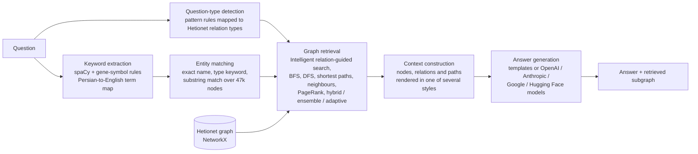

# GraphRAG over Hetionet

[](LICENSE)

## Overview

This repository contains my B.Sc. project: a retrieval-augmented generation (RAG) system that answers biomedical questions by retrieving evidence from a knowledge graph instead of from text passages.

The knowledge graph is [Hetionet v1.0](https://het.io), which integrates 29 public biomedical resources into 47,031 nodes of 11 types (genes, compounds, diseases, anatomies, symptoms, side effects, pathways, biological processes, and others) and 2,250,197 edges of 24 relation types (for example *Compound–treats–Disease*, *Disease–associates–Gene*, *Compound–binds–Gene*). The system loads Hetionet as an undirected NetworkX graph. For a question it:

1. finds the entities the question mentions and the relation types it asks about,
2. retrieves a subgraph around those entities with one of several graph-search strategies,
3. turns the subgraph into a textual context, and
4. passes that context to a template-based generator or to an LLM API to produce the answer.

The repository also includes a Flask web interface, a module that builds new knowledge graphs from free text, URLs, or Wikipedia pages, partial support for Persian questions, and a reproducible evaluation against a standard dense-retrieval RAG baseline (see [Evaluation](#evaluation)). In that evaluation the baseline retrieves far more of the correct answers on single-relation questions, while the best GraphRAG method is slightly ahead on two-hop questions.

## Architecture



Main modules:

- `graphrag_service.py`: the core pipeline. It covers keyword extraction, question-type detection (`analyze_question_intent`), entity matching (`match_tokens_to_nodes`), the retrieval methods (`RetrievalMethod`, `retrieve_information`), context construction (`create_context_text`), and answer generation (`GenerationModel`, `generate_answer`).
- `enhanced_graphrag_service.py` and `enhanced_context_generator.py`: an extended service with configurable retrieval and community detection, plus richer context templates.
- `node_lookup_system.py`: maps Hetionet node ids to names, types, and short descriptions for display.
- `text_to_graph_service.py`, `url_extractor.py`, `wikipedia_extractor.py`: build a graph from text using rule-based, spaCy, or LLM-based entity and relation extraction.
- `persian_normalizer.py`, `persian_models.py`: Persian text normalization and term mapping.
- `web_app.py` with `templates/` and `static/`: the Flask interface and JSON API.
- `rebuild_graph.py`: builds the NetworkX graph from the Hetionet files.
- `evaluation/`: the question generator, the dense-RAG baseline, and the evaluation runner.

## Installation

Requires Python 3.10 or newer (developed and tested with Python 3.13 on Windows).

```bash
git clone https://github.com/amirhosseinkho/graphRAG.git
cd graphRAG
python -m venv .venv
source .venv/bin/activate          # Windows: .venv\Scripts\activate
pip install -r requirements.txt
python -m spacy download en_core_web_sm

# Download Hetionet v1.0 (about 15 MB compressed) and build hetionet_graph.pkl
python scripts/download_data.py
```

`scripts/download_data.py` downloads `hetionet-v1.0-nodes.tsv` and `hetionet-v1.0-edges.sif.gz` from the official [hetio/hetionet](https://github.com/hetio/hetionet) repository. It then decompresses the edges to `edges.sif` and runs `rebuild_graph.py`, which writes `hetionet_graph.pkl` to the repository root. None of these files are tracked by git. Without the graph file, the service falls back to a small built-in sample graph.

LLM-based generation is optional. The template generators work offline. To use an API model, set the matching key before starting the app:

```bash
export OPENAI_API_KEY=...          # Windows PowerShell: $env:OPENAI_API_KEY="..."
```

## Usage

**Web interface**

```bash
python web_app.py
```

Then open http://localhost:5000. From the interface you can choose the retrieval method, the context style, and the generation model, and inspect the retrieved subgraph. Other pages let you upload a graph, build a graph from text or a URL, and switch the active graph.

**Python**

```python
from graphrag_service import GraphRAGService, RetrievalMethod, GenerationModel

service = GraphRAGService()  # loads hetionet_graph.pkl from the working directory
result = service.process_query(
    "Which compounds treat hypertension?",
    RetrievalMethod.INTELLIGENT,  # or BFS, DFS, SHORTEST_PATH, NEIGHBORS, ADAPTIVE, ...
    GenerationModel.SIMPLE,       # template-based; e.g. OPENAI_GPT_4O_MINI needs an API key
)
print(result["matched_nodes"])
print(result["context_text"])
print(result["answer"])
```

**HTTP API**

```bash
curl -X POST http://localhost:5000/api/process_query \
     -H "Content-Type: application/json" \
     -d '{"query": "Which compounds treat hypertension?", "retrieval_method": "INTELLIGENT", "generation_model": "SIMPLE"}'
```

`retrieval_method` takes any `RetrievalMethod` member name, and `generation_model` takes any `GenerationModel` member name.

## Evaluation

The evaluation checks whether retrieval puts the correct answer entities into the context that would be sent to the LLM. Every number below comes from `evaluation/results/2026-10-09_summary.json`, produced by the scripts in `evaluation/` at commit `e5b5815`. The run used a CPU-only Windows laptop on 2026-10-09.

**Questions.** `evaluation/make_questions.py` generates 56 questions from Hetionet itself (seed 42), with 8 questions for each of 7 templates. Six templates follow one relation: genes associated with a disease, compounds that treat a disease, genes a compound binds, symptoms of a disease, anatomies where a disease localizes, and side effects of a compound. One template follows two relations: genes bound by compounds that treat a disease. The gold answers are read directly from the graph edges. Each question has 3–30 gold answers (3–60 for the two-hop template).

**Systems.**
- **GraphRAG** with three of its retrieval methods: `INTELLIGENT` (the relation-guided search), `BFS` (the web interface default), and `ADAPTIVE`. All three use the default configuration.
- **Dense RAG baseline** (`evaluation/baseline_rag.py`). Every Hetionet edge is rendered as text, grouped by node and relation. For example: "hypertension (Disease). Compounds that treat it: …". This gives 334,555 chunks of up to 400 characters, embedded with `all-MiniLM-L6-v2`. The top chunks by cosine similarity are concatenated up to 2,000 characters, the same as GraphRAG's configured `max_context_length`.

**Metrics.** No LLM API key was available, so only retrieval is evaluated, not answer quality.
- *Recall in first 2,000 chars*: the share of gold entities that appear in the first 2,000 characters of the context. This compares all systems at the same context size.
- *Recall in full context* and *hit rate*: the share of gold entities in the whole context, and the share of questions with at least one gold entity there.
- *Node recall*: the share of gold entities among the graph nodes GraphRAG retrieved, before the context is built.

Questions slower than 10 minutes would count as failures; none reached that limit.

| System | n | Recall in first 2,000 chars | Recall in full context | Hit rate | Node recall | Mean context (chars) | Mean latency (s) |
|---|---|---|---|---|---|---|---|
| GraphRAG `INTELLIGENT` | 56 | 31.3% | 31.9% | 57.1% | 31.4% | 55,876 | 57 |
| GraphRAG `BFS` | 56 | 13.1% | 13.1% | 35.7% | 12.9% | 4,741 | 6.5 |
| GraphRAG `ADAPTIVE` | 56 | 5.4% | 5.4% | 23.2% | 4.9% | 1,734 | 9.2 |
| Dense RAG baseline | 56 | 88.1% | 88.1% | 96.4% | n/a | 1,850 | 0.04 |

Recall in the first 2,000 characters, by question template:

| Template | `INTELLIGENT` | `BFS` | `ADAPTIVE` | Dense RAG |
|---|---|---|---|---|
| Disease → associated genes | 35.3% | 1.1% | 4.2% | 100.0% |
| Disease → treating compounds | 71.1% | 17.5% | 13.6% | 100.0% |
| Compound → bound genes | 0.0% | 37.1% | 0.0% | 100.0% |
| Disease → symptoms | 28.8% | 14.2% | 7.7% | 100.0% |
| Disease → anatomies | 8.3% | 3.5% | 8.7% | 100.0% |
| Compound → side effects | 56.2% | 18.2% | 3.3% | 100.0% |
| Disease → compounds → bound genes (2 hops) | 19.3% | 0.3% | 0.0% | 16.4% |

To reproduce the run (after `scripts/download_data.py`):

```bash
python evaluation/make_questions.py
python evaluation/run_eval.py      # add --llm-model gpt-4o-mini with OPENAI_API_KEY set to also score answers
```

### Limitations

- **The baseline is favoured by the benchmark design.** The questions and the baseline's text chunks are both generated from the same Hetionet edges. A chunk header such as "uterine cancer (Disease). Compounds that treat it:" nearly paraphrases its question, so one-hop questions are close to ideal for dense retrieval. This setup measures retrieval over Hetionet's own content, not over free text. When the answer is spread across many chunks (the two-hop template), the baseline drops to 16.4%, slightly below `INTELLIGENT` at 19.3%.
- **GraphRAG's main errors come from entity matching and question typing, not from graph search.** Inspecting the matched nodes shows three repeated failures:
  - Generic words are matched to unrelated nodes: "genes" and "compounds" to Gene Ontology processes, "symptoms" to a side effect, "effects" to a pathway.
  - Multi-word disease names are matched only partly: "uterine cancer", "lung cancer" and "larynx cancer" all map to the generic *cancer* node.
  - Some phrasings fall through the question-type rules. "Which genes does X bind?" and "In which anatomical structures does X localize?" are classified as *general*, which explains the 0% and 8% recall on those templates.
- **`INTELLIGENT` contexts do not respect the configured length limit.** They average 55,876 characters (maximum 161,513), against the 2,000-character setting. Its recall barely changes when the context is cut to 2,000 characters, because the relevant nodes are listed first. Parts of the context templates are written in Persian.
- **Retrieval is slow on the full graph.** On CPU, `INTELLIGENT` takes about 57 s per question. Two output-preserving fixes made during this evaluation (enumerating only the first shortest paths, and skipping the neighbour scan at the last DFS level) removed a worst case of about one hour per question. The baseline answers in 0.04 s, but only after a one-time embedding of the corpus that took about 2.5 hours on CPU.
- **Two retrieval methods were not evaluated.** `KG_SEARCH` and `N_HOP_RETRIEVAL` returned no nodes on the test questions tried locally. They appear to depend on components that are not set up here (an LLM backend or a search index).
- **The sample is small and templated.** The benchmark has 56 questions from one run. They use exact Hetionet entity names, so real user questions would be harder for both systems.

## Project structure

```
graphRAG/
├── graphrag_service.py            # core pipeline
├── enhanced_graphrag_service.py   # extended service (configurable retrieval, communities)
├── enhanced_context_generator.py  # context templates
├── node_lookup_system.py          # node id -> name / type / description
├── text_to_graph_service.py       # text -> knowledge graph
├── url_extractor.py, wikipedia_extractor.py
├── persian_normalizer.py, persian_models.py
├── web_app.py, templates/, static/
├── rebuild_graph.py               # Hetionet files -> hetionet_graph.pkl
├── scripts/download_data.py       # downloads Hetionet and builds the graph
├── graphrag_new/, rag_new/        # adapted GraphRAG/RAG utilities (see NOTICE)
├── evaluation/                    # benchmark questions, baseline, runner, results
├── tests/                         # test and debugging scripts
├── docs/fa/                       # Persian documentation
└── requirements.txt
```

## License and third-party code

The project is released under the [MIT License](LICENSE). `graphrag_new/search.py` and `rag_new/nlp/search.py` are adapted from [RAGFlow](https://github.com/infiniflow/ragflow) and keep their Apache-2.0 license headers. [NOTICE](NOTICE) lists all third-party code. Hetionet itself is distributed by its authors under CC0 1.0 where possible. Some of its integrated resources carry their own licenses; see [het.io](https://het.io/about/).

## Persian documentation

The original Persian documentation, including the run guide, troubleshooting notes, and reports on the text-to-graph module, is in [docs/fa/](docs/fa/README.md).
